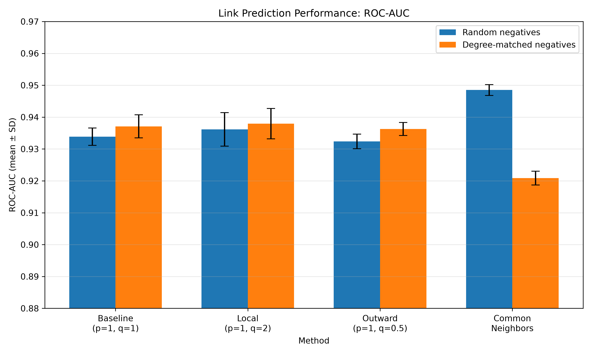
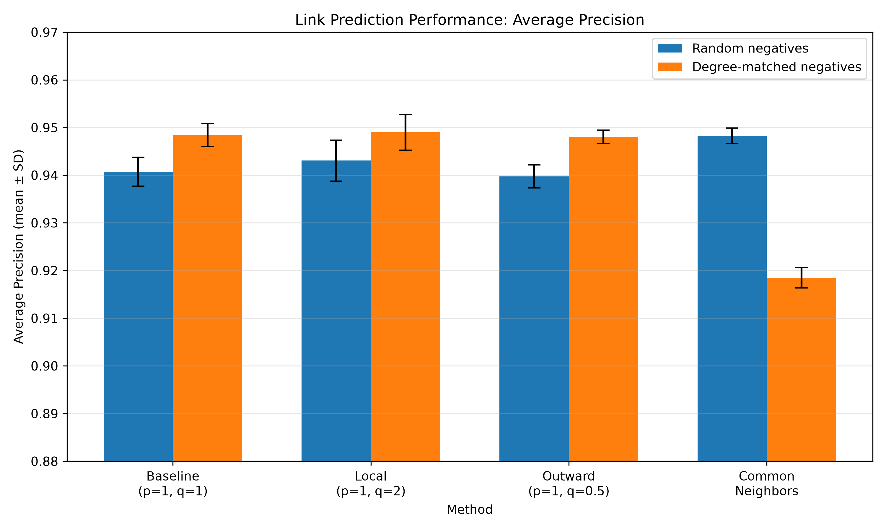

# Predicting Protein–Protein Interactions Using node2vec

## Project Overview

This project investigates whether node2vec can learn useful vector representations of proteins from a protein–protein interaction (PPI) network and use these representations to predict missing interactions.

The project also examines how different node2vec random-walk parameters and negative-sampling strategies influence link-prediction performance.

## Research Question

Can node2vec learn useful representations of proteins from a PPI network, and how do different random-walk parameters affect its ability to predict missing interactions?

An additional experimental question is:

How does the choice of negative-sampling strategy influence the relative performance of node2vec and Common Neighbors?

## Hypotheses

Before conducting the experiments, the following expectations were considered:

1. Under random negative sampling, Common Neighbors is expected to perform well because randomly selected protein pairs are unlikely to share common neighbors.
2. Under degree-matched negative sampling, Common Neighbors is expected to perform less effectively because the negative pairs have more similar degree characteristics to positive pairs.
3. Node2vec may retain better predictive performance under degree-matched sampling because its embeddings represent broader network context rather than relying only on shared neighbors.

The experimental results were broadly consistent with these expectations.

## Dataset

The project uses human physical protein–protein interaction data from STRING version 12.5.

- Organism: *Homo sapiens*
- Taxonomy ID: 9606
- Interaction type: Physical interactions
- Minimum STRING combined confidence score: 700
- Dataset format: Compressed tab-separated text file

**Data source:**

https://stringdb-downloads.org/download/stream/protein.physical.links.v12.5/9606.protein.physical.links.v12.5.min700.onlyAB.txt.gz

The dataset is downloaded using `scripts/download_data.py`.

## Network Preprocessing

The preprocessing pipeline:

- Removes missing records.
- Retains the protein identifiers and combined interaction scores.
- Removes self-interactions.
- Removes duplicate undirected interactions.
- Constructs an undirected, weighted PPI network.
- Calculates network-level statistics.

The cleaned network contains:

| Network property | Value |
|---|---:|
| Proteins (nodes) | 14,404 |
| Interactions (edges) | 145,815 |
| Average degree | 20.25 |
| Network density | 0.00141 |
| Connected components | 169 |
| Largest connected component | 13,996 proteins |
| Average clustering coefficient | 0.380 |

Link-prediction experiments are performed on the largest connected component.

## Methods

### 1. Train-test split

The largest connected component is divided into training and test interactions.

- 80% of eligible interactions are retained for training.
- 20% are held out as positive test interactions.
- Edges are removed only when both endpoints retain at least one training connection.
- Three random seeds are used: 42, 123, and 2026.

The training network is used to generate embeddings and calculate network-based features.

### 2. node2vec embeddings

node2vec learns protein representations using biased second-order random walks and the Skip-gram model.

Three configurations are compared:

| Configuration | p | q | Intended walk behaviour |
|---|---:|---:|---|
| Baseline | 1 | 1 | Unbiased random walks |
| Local | 1 | 2 | More local exploration |
| Outward | 1 | 0.5 | More outward exploration |

The remaining node2vec parameters are:

- Embedding dimensions: 128
- Walk length: 80
- Number of walks per node: 10
- Context window: 10
- Workers: 1

These three configurations represent a small parameter comparison rather than an exhaustive search of possible p and q values.

### 3. Link prediction

The Hadamard product of two protein embedding vectors is used to represent a candidate protein pair.

A machine-learning pipeline consisting of StandardScaler and Logistic Regression is trained to distinguish positive and negative protein pairs.

This is a supervised link-prediction approach: the classifier learns from labelled protein-pair examples using features derived from node2vec embeddings.

### 4. Negative sampling strategies

Two negative-sampling strategies are evaluated.

**Random negative sampling**

Random protein pairs without recorded interactions in the original network are selected as negative examples.

**Degree-matched negative sampling**

Negative pairs are sampled to have similar logarithmic degree bins to positive pairs.

The logarithmic degree bin is calculated as:

`floor(log2(degree))`

Each negative-pair endpoint is allowed to differ by at most one degree bin from its corresponding positive-pair endpoint.

This provides a more controlled evaluation by reducing differences in endpoint degree between positive and negative examples.

Importantly, negative pairs represent interactions not recorded in the dataset; they are not experimentally confirmed biological non-interactions.

### 5. Common Neighbors baseline

Common Neighbors is included as a classical, unsupervised network-based link-prediction baseline.

The score for a protein pair is the number of shared neighbors in the training network:

`CN(u,v) = |N(u) ∩ N(v)|`

where N(u) and N(v) represent the neighbors of proteins u and v.

**Comparison with node2vec:** Common Neighbors directly scores pairs using shared-neighbor information, whereas node2vec uses learned embeddings and a supervised Logistic Regression classifier. Therefore, these methods represent different approaches to link prediction rather than identical classifiers.

### 6. Repeated experiments

All experiments are repeated using three random seeds:

- 42
- 123
- 2026

The mean and standard deviation are calculated across the three runs.

### 7. Evaluation metrics

The following metrics are reported:

- ROC-AUC
- Average Precision (AP)
- Accuracy
- F1-score

ROC-AUC and Average Precision are emphasized when comparing ranking performance across methods.

## Results

The following values represent mean ± standard deviation across three random seeds.

### Random negative sampling

| Method | ROC-AUC | Average Precision |
|---|---:|---:|
| Baseline | 0.9339 ± 0.0028 | 0.9407 ± 0.0030 |
| Local | 0.9362 ± 0.0053 | 0.9431 ± 0.0043 |
| Outward | 0.9324 ± 0.0023 | 0.9398 ± 0.0024 |
| Common Neighbors | 0.9485 ± 0.0017 | 0.9483 ± 0.0016 |

### Degree-matched negative sampling

| Method | ROC-AUC | Average Precision |
|---|---:|---:|
| Baseline | 0.9371 ± 0.0036 | 0.9484 ± 0.0024 |
| Local | 0.9379 ± 0.0048 | 0.9490 ± 0.0037 |
| Outward | 0.9363 ± 0.0020 | 0.9480 ± 0.0014 |
| Common Neighbors | 0.9209 ± 0.0022 | 0.9185 ± 0.0022 |

## Performance Visualizations

The following figures compare the performance of the three node2vec configurations and the Common Neighbors baseline under random and degree-matched negative sampling. Bars represent mean performance across three random seeds (42, 123, and 2026), and error bars represent standard deviation.

### ROC-AUC



### Average Precision



## Interpretation

All three node2vec configurations achieved strong link-prediction performance in both evaluation settings.

Among the node2vec configurations, the local setting (p = 1, q = 2) achieved the highest mean ROC-AUC and Average Precision under both negative-sampling strategies. However, the differences were relatively small, and the three-run experiment does not establish statistically significant superiority.

Common Neighbors performed best under random negative sampling. However, its performance decreased under degree-matched negative sampling.

Under degree-matched sampling, all three node2vec configurations achieved higher ROC-AUC and Average Precision than Common Neighbors.

These findings suggest that the negative-sampling strategy influences measured link-prediction performance and the relative ranking of prediction methods.

Node2vec-based features may capture useful network information beyond simple common-neighbor overlap. However, the current experiments do not establish which network properties contribute to this performance, and further controlled experiments would be needed to support that interpretation.

## Limitations

- Only three random seeds were used; more repetitions would provide a stronger assessment of robustness.
- Degree matching is approximate because it uses logarithmic degree bins with a tolerance of one bin.
- Only one biological interaction dataset was examined.
- STRING interactions are computationally integrated evidence and do not necessarily represent experimentally verified interactions in every case.
- Negative examples are unobserved interactions, not confirmed non-interactions.
- No experimental biological validation of predicted interactions was performed.
- No statistical significance testing was conducted to establish differences between configurations.
- Only three node2vec parameter configurations were evaluated; a broader parameter search could identify other useful configurations.
- **Training and testing feature context:** Positive training pairs are present in the training network used to generate node2vec embeddings, whereas held-out positive test pairs are absent. This creates a potential difference in feature context between training and testing examples and may influence the evaluation. The current implementation does not use a separate validation set of removed positive edges to train the classifier.
- Common Neighbors is an unsupervised scoring method, whereas node2vec uses a supervised Logistic Regression classifier. Their comparison should therefore be interpreted as a comparison of different link-prediction approaches.

The results should be interpreted as performance on a defined link-prediction benchmark rather than direct confirmation of novel biological interactions.

## Conclusion

This project investigated node2vec-based protein interaction prediction and examined how negative-sampling strategies influence its performance relative to Common Neighbors.

Common Neighbors performed best under random negative sampling, while node2vec configurations performed better under approximate degree-matched negative sampling.

These findings demonstrate that the choice of negative-sampling strategy can substantially affect the evaluation and relative ranking of network-based link-prediction methods.

Although node2vec showed promising performance, further validation across datasets, broader parameter exploration and improved experimental designs are required before drawing conclusions about its ability to identify novel biological interactions.

## How to Run the Project
Run the scripts from the project root directory.

The general workflow is:

1. Download the STRING dataset using download_data.py.

2. Preprocess the interaction data using preprocess_network.py.

3. Prepare the training and testing data using prepare_link_prediction_v2.py.

4. Generate node2vec embeddings using generate_embeddings_v2.py.

5. Run link-prediction evaluation using link_prediction_v2.py.

6. Run the Common Neighbors baseline using common_neighbors.py.

7. Generate result visualizations using the plotting scripts.

### Requirements

Python 3.12 is recommended.

Install dependencies:

```bash
pip install -r requirements.txt
```

### Step 1: Download the dataset

```bash
python scripts/download_data.py
```

### Step 2: Preprocess the network

```bash
python scripts/preprocess_network.py
```

### Step 3: Prepare training and test datasets

Run once for each seed:

```bash
python scripts/prepare_link_prediction_v2.py 42
python scripts/prepare_link_prediction_v2.py 123
python scripts/prepare_link_prediction_v2.py 2026
```

### Step 4: Generate node2vec embeddings

```bash
python scripts/generate_embeddings_v2.py 42
python scripts/generate_embeddings_v2.py 123
python scripts/generate_embeddings_v2.py 2026
```

### Step 5: Generate degree-matched negative examples

```bash
python scripts/degree_matched_negatives_v2.py 42
python scripts/degree_matched_negatives_v2.py 123
python scripts/degree_matched_negatives_v2.py 2026
```

### Step 6: Evaluate link prediction

Run the evaluation script once after all three seeds have been prepared:

```bash
python scripts/link_prediction_v2.py
```

This evaluates all three node2vec configurations and the Common Neighbors baseline under both negative-sampling strategies.

The script saves individual-run results and the mean ± standard deviation summary.

## Repository Structure

The repository contains scripts for downloading and preprocessing the STRING dataset, constructing the interaction network, generating node2vec embeddings, performing link prediction, evaluating the Common Neighbors baseline and visualizing results.

Important scripts include:
download_data.py – downloads the STRING interaction dataset.
preprocess_network.py – preprocesses the interaction network.
prepare_link_prediction_v2.py – prepares the link-prediction data.
generate_embeddings_v2.py – generates node2vec embeddings.
link_prediction_v2.py – evaluates node2vec-based link prediction.
common_neighbors.py – implements the Common Neighbors baseline.
degree_matched_negatives.py and degree_matched_negatives_v2.py – support degree-matched negative sampling.
link_prediction_degree_matched.py – evaluates degree-matched link prediction.
plot_repeated_results_v2.py – visualizes repeated experimental results.
plot_results.py and plot_sampling_comparison.py – generate result visualizations.

The versioned scripts are retained from different stages of development. The scripts ending in _v2 contain the updated repeated-experiment workflow where applicable.

```text
node2vec-PPI-Link-Prediction/
│
├── data/
│   └── STRING dataset (downloaded separately)
│
├── scripts/
│   ├── download_data.py
│   ├── preprocess_network.py
│   ├── prepare_link_prediction.py
│   ├── prepare_link_prediction_v2.py
│   ├── generate_embeddings.py
│   ├── generate_embeddings_v2.py
│   ├── degree_matched_negatives.py
│   ├── degree_matched_negatives_v2.py
│   ├── link_prediction.py
│   ├── link_prediction_v2.py
│   ├── common_neighbors.py
│   ├── plot_results.py
│   └── plot_sampling_comparison.py
│
├── results/
│   ├── figures/
│   │   ├── repeated_run_roc_auc.png
│   │   └── repeated_run_average_precision.png
│   │
│   ├── repeated_runs/
│   │   ├── seed_42/
│   │   ├── seed_123/
│   │   ├── seed_2026/
│   │   ├── all_repeated_run_results.csv
│   │   └── repeated_run_mean_sd.csv
│   │
│   ├── network_statistics.csv
│   ├── node2vec_comparison.csv
│   ├── degree_matched_comparison.csv
│   └── combined_sampling_comparison.csv
│
├── requirements.txt
├── .gitignore
└── README.md
```

## References

Grover, A. & Leskovec, J. (2016). node2vec: Scalable Feature Learning for Networks. *Proceedings of the 22nd ACM SIGKDD International Conference on Knowledge Discovery and Data Mining*, 855–864.

https://doi.org/10.1145/2939672.2939754

STRING database: https://string-db.org/
